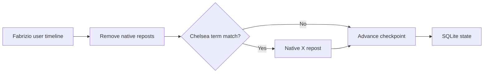

# Fabrizio Chelsea Bot

A small, production-minded X bot that watches [@FabrizioRomano](https://x.com/FabrizioRomano)
and natively reposts only posts that mention Chelsea. It uses the official X API v2, preserves
the original author and media, and never scrapes the website.

> The safe default is dry-run mode. Nothing is reposted until you explicitly use `--live` or set
> `DRY_RUN=false`.

## How it works



The bot polls `GET /2/users/:id/tweets`, applies case-insensitive literal matching with word
boundaries, and calls `POST /2/users/:id/retweets` only for matches. Native reposts are used because
they keep attribution and attachments intact. X currently restricts `quote_tweet_id` creation to
Enterprise plans.

Important safeguards:

- first live run baselines at the newest visible source post, so it does not flood the account;
- SQLite checkpointing and an event audit make runs idempotent;
- posts are handled oldest-first and state advances only after a confirmed action;
- a per-run repost cap prevents an accidental burst;
- a process lock and GitHub Actions concurrency prevent overlapping runs;
- only hashes, IDs, timestamps, and action outcomes are stored - not full post text;
- HTTP GET requests retry transient failures; write requests are not blindly retried.

## Quick start

Requirements: Python 3.11+ and an X developer App with Read and write permission.

```bash
python -m venv .venv
# Windows PowerShell: .venv\Scripts\Activate.ps1
# macOS/Linux: source .venv/bin/activate
python -m pip install -e .
cp .env.example .env
```

Fill the five X credentials in `.env`, then run:

```bash
chelsea-bot doctor
chelsea-bot run --dry-run
chelsea-bot run --live
```

The first live run establishes the baseline and intentionally creates no repost. Later live runs
process only newer posts. To intentionally process the recent timeline on an empty database:

```bash
chelsea-bot run --live --bootstrap-history
```

Use that option carefully. `MAX_REPOSTS_PER_RUN=5` limits the resulting burst.

## Configuration

| Variable | Default | Purpose |
| --- | --- | --- |
| `X_BEARER_TOKEN` | required | App-only token for public reads |
| `X_API_KEY` | live mode required | OAuth 1.0a consumer key |
| `X_API_SECRET` | live mode required | OAuth 1.0a consumer secret |
| `X_ACCESS_TOKEN` | live mode required | Bot-account user token |
| `X_ACCESS_TOKEN_SECRET` | live mode required | Bot-account token secret |
| `SOURCE_USERNAME` | `FabrizioRomano` | Source handle without `@` |
| `CHELSEA_TERMS` | Chelsea variants | Comma-separated literal match terms |
| `STATE_PATH` | `data/state.db` | Persistent SQLite database |
| `DRY_RUN` | `true` | Safe default when CLI mode is omitted |
| `BOOTSTRAP_MODE` | `baseline` | `baseline` or `replay` |
| `MAX_RESULTS` | `100` | Posts requested per page, 5-100 |
| `MAX_PAGES` | `5` | Maximum source pages per poll |
| `MAX_REPOSTS_PER_RUN` | `5` | Burst safety limit, 1-25 |
| `REQUEST_TIMEOUT_SECONDS` | `20` | Network timeout |
| `LOG_LEVEL` | `INFO` | Python log level |

`CHELSEA_TERMS` defaults to `chelsea,chelsea fc,chelseafc,@chelseafc,#chelseafc`. The matcher is
case-insensitive and boundary-aware, so `CHELSEA` matches while an unrelated longer word containing
the same letters does not.

## Commands

```text
chelsea-bot doctor             Validate read/write credentials and user lookups; no repost.
chelsea-bot run --dry-run      Preview one cycle without state changes or reposts.
chelsea-bot run --live         Run one real cycle.
chelsea-bot daemon --live      Poll forever; default interval is 300 seconds.
chelsea-bot status             Show checkpoint and audit counts without network access.
```

CLI `--live`/`--dry-run` overrides `DRY_RUN`. `doctor` never posts.

## GitHub Actions deployment

The included `Chelsea repost bot` workflow runs every ten minutes, offset from the top of the hour.
It is gated until the repository variable `BOT_ENABLED` equals `true`, so cloning or forking this
repository cannot accidentally activate it.

1. Add these Actions secrets: `X_BEARER_TOKEN`, `X_API_KEY`, `X_API_SECRET`, `X_ACCESS_TOKEN`, and
   `X_ACCESS_TOKEN_SECRET`.
2. Run the workflow manually once. That run establishes the baseline.
3. Confirm the run log and the bot account.
4. Add an Actions repository variable named `BOT_ENABLED` with value `true`.

The workflow persists `data/state.db` in a uniquely keyed Actions cache and restores the most recent
state on each scheduled run. The cache contains no credentials or source post text. For stronger
durability and precise scheduling, use the Docker deployment on an always-on host.

## Docker deployment

After creating `.env`:

```bash
docker compose up -d --build
docker compose logs -f bot
```

Compose runs `chelsea-bot daemon --live --interval 300` and stores SQLite data in a named volume.
Stop it with `docker compose down`. Keep the volume to retain the checkpoint; use
`docker compose down -v` only if you intentionally want to erase state.

## Tests and quality checks

```bash
python -m pip install -e ".[dev]"
ruff check .
pytest --cov=chelsea_bot --cov-report=term-missing
```

Tests use fake X clients and never call the live API.

## Cost and platform notes

The X API is pay-per-usage. Check current endpoint prices and credit balance in the X Developer
Console before enabling the schedule. Polling with `since_id` minimizes returned resources, and X
documents 24-hour resource deduplication for repeated reads. The bot does not bypass rate limits or
access controls. You are responsible for X's Developer Agreement, automation rules, and any local
laws that apply to the bot account.

## Full setup guide

The extensive illustrated setup, deployment, operations, security, cost, and troubleshooting guide
is available as [PDF](output/pdf/Fabrizio_Chelsea_Bot_Setup_Guide.pdf) and as
[Markdown](docs/SETUP_GUIDE.md).

## References

- [X user timelines](https://docs.x.com/x-api/posts/timelines/introduction)
- [X repost endpoint](https://docs.x.com/x-api/users/repost-post)
- [X OAuth 1.0a](https://docs.x.com/fundamentals/authentication/oauth-1-0a/overview)
- [X pricing](https://docs.x.com/x-api/getting-started/pricing)
- [GitHub Actions secrets](https://docs.github.com/en/actions/concepts/security/secrets)
- [GitHub Actions workflow syntax](https://docs.github.com/en/actions/reference/workflows-and-actions/workflow-syntax)

## License

MIT. This project is independent and is not affiliated with Fabrizio Romano, Chelsea FC, or X.
